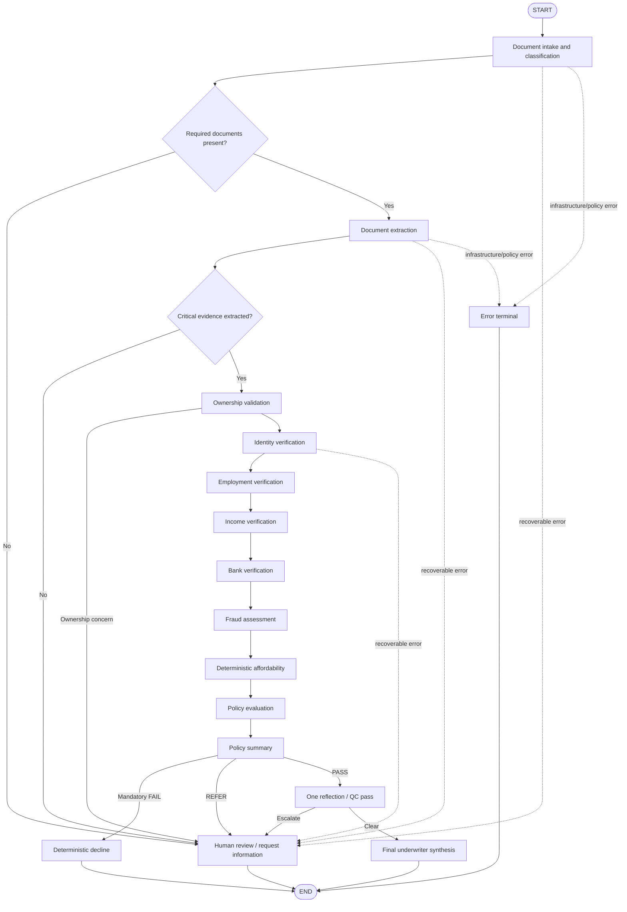
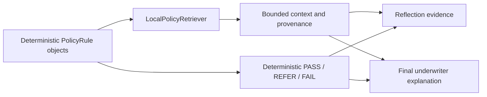
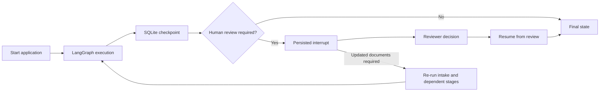

# Agentic Mortgage Application Evaluator

A Python prototype for UK mortgage-document assessment. PDF/OCR extraction and local-first semantic specialists feed deterministic calculations and policy rules inside a conditional LangGraph workflow.

This is an engineering prototype, not lending advice or a production decisioning system. The included thresholds are the repository's prototype rules; they are not represented as a lender's real policy.

## Architecture

The layers have distinct responsibilities:

- Extraction: PDF text with OCR fallback, classification, passport, employment, payslip, and bank-statement extraction.
- Verification: ownership, identity, employment, income, and bank-account consistency.
- Deterministic domain logic: age, income averages, monthly expenses, disposable income, DTI, affordability score, and policy comparisons.
- Risk and policy: fraud assessment followed by typed `PolicyResult` records and a deterministic `PASS`, `FAIL`, or `REFER` summary.
- Quality and decision: one reflection/QC pass, specialist-output synthesis by the final underwriter, or a structured human-review record.

Every workflow agent exposes the same `validate_input -> run -> validate_output` lifecycle through `BaseAgent.execute`. Workflow nodes catch failures and add structured `WorkflowError` values without logging document contents.

Verification uses exact and normalized comparisons first. Complete, unambiguous evidence is
resolved deterministically; ambiguous names, employment wording, transactions, and contextual
fraud concerns retain semantic LLM review. Final underwriting receives specialist assessments,
policy results, and quality-control output rather than raw document text.



`tools.rag.PolicyRetriever` defines the policy-retrieval extension point. The default
`LocalPolicyRetriever` builds its catalogue from the active internal policy rules.

## Policy retrieval and provenance

The default retriever is local, deterministic, and requires no embeddings, vector database,
network service, or additional credentials. Its catalogue is generated only from the five
`PolicyRule` objects already encoded in the application; it does not add lender or regulatory
policy. Keyword overlap, metadata filters, stable scoring, and rule-ID matching return a bounded
list of typed records containing policy ID, title, source, content, metadata, and score.



Deterministic evaluation remains authoritative. Retrieved text supports traceability and
explanation only and cannot override policy outcomes. Irrelevant or empty queries return no
records. Future local or remote retrievers can implement the same `PolicyRetriever` protocol.

## Fraud and document-integrity assessment

Fraud assessment uses typed signals with `DETECTED`, `SUSPECTED`, `NOT_DETECTED`, and
`NOT_ASSESSED` statuses. Deterministic checks cover specialist-verification contradictions,
normalized applicant/employer/account consistency, declared/payslip/bank income consistency,
salary-credit variance, and recorded extraction/readability quality. Missing evidence and
unavailable capabilities remain explicitly unassessed rather than being treated as passed.

The fraud score uses coarse severity weights and only the strongest active signal per category,
avoiding double-counting correlated checks. Semantic LLM reasoning may explain supplied active
signals and recommend review, but cannot add factual signals or change the deterministic score.
The existing `FRAUD001` threshold remains authoritative.

This is not a forensic document-authentication system. It does not detect Photoshop edits,
forged signatures, AI-generated documents, pixel manipulation, or guarantee authenticity from
PDF metadata. It also has no external identity, issuer, banking, biometric, or fraud-database
integration.

## Running locally

Windows PowerShell:

```powershell
py -3.11 -m venv .venv
.\.venv\Scripts\Activate.ps1
python -m pip install --upgrade pip
python -m pip install -r requirements.txt
Copy-Item .env.example .env
```

Install [Ollama](https://ollama.com/download), start its local server, and pull the configured model:

```powershell
ollama pull qwen2.5:7b
ollama serve
```

If Ollama is already running, leave that server running and skip `ollama serve`. The default
`.env.example` selects `LLM_PROVIDER=local`, `LOCAL_LLM_MODEL=qwen2.5:7b`, and
`LOCAL_LLM_BASE_URL=http://localhost:11434`. No cloud key is needed for local execution.
The provider's `health_check()` tests server reachability and model availability. If local
inference is unavailable, the workflow records `LOCAL_MODEL_UNAVAILABLE` and routes to review.
Never commit `.env`.

Run all offline tests (no API key required):

```powershell
python -m pytest
```

Run the included sample application (uses the configured local model by default):

```powershell
python main.py sample_application
```

Deterministic Python handles arithmetic, matching, fraud scoring, policy, and routing first.
Semantic tasks use the local model only where needed; unresolved ambiguity goes to human review.
For explicit cloud fallback, set `ALLOW_CLOUD_FALLBACK=true` and provide `MISTRAL_API_KEY`.
With fallback disabled, no cloud provider is instantiated. `LLM_PROVIDER=mistral` also requires
the explicit opt-in flag. Malformed local structured output gets one repair attempt, then a
structured workflow error rather than an unbounded retry.

## Unified check results

Every workflow state contains a regenerated `check_results` snapshot covering intake,
extraction, ownership, verification, fraud signals, affordability, policy, and reflection.
`PASS` means the check ran without a finding; `FAIL` denotes a failed requirement or policy
rule; `REFER` calls for review; `NOT_ASSESSED` means the evidence or capability was unavailable.
The CLI prints the table after the workflow summary, including successful checks:

| Stage | Check | Status | Reason | Metric | Action |
|---|---|---|---|---|---|
| Document Intake | Passport present | PASS | Document type found | 1 file(s) | Continue |
| Policy | Identity Verification | FAIL | Observed value breaches mandatory rule | observed False; target True | Decline |

`CheckSummary` provides pass/fail/refer/unassessed subsets, counts, and the first failed
check/stage. This is a reporting view, not a second policy engine. The snapshot persists in
SQLite checkpoints and is rebuilt after updated-evidence recomputation to remove stale rows.
Rows and structured logs omit raw documents and identifying evidence; checkpoints themselves
still contain sensitive application state and require access control.

The workflow returns once it reaches a final decision, structured pending review/request-information
state, or unrecoverable error terminal. Required document types can be configured through
`MortgageWorkflow(required_documents=...)`. The non-persistent API remains available for simple
CLI runs; durable review and resume operations use the service described below.

## Running the Demo UI

The Streamlit application is a thin local frontend over `PersistentMortgageWorkflow`; it does
not duplicate underwriting, policy, routing, or persistence logic.

1. Activate the Python 3.11 environment and install dependencies:

   ```powershell
   .\.venv\Scripts\Activate.ps1
   python -m pip install -r requirements.txt
   ```

2. Start Ollama and make sure the configured model is installed:

   ```powershell
   ollama pull qwen2.5:7b
   ollama serve
   ```

3. Start the demo from the repository root:

   ```powershell
   streamlit run app.py
   ```

4. Upload a synthetic application document set and click **Run Underwriting**. A referral caused
   by incomplete or inconsistent evidence is a valid workflow result and is presented through the
   Human Review panel rather than as an application failure.

The upload interface accepts validated PDF, PNG, JPG, and JPEG files, assigns generated filenames,
and removes the temporary upload directory after synchronous processing. Each browser session has
an isolated temporary SQLite database. The sidebar can load only application IDs from that session;
review decisions and updated-evidence resumes call the existing service APIs. The UI displays
structured extracted fields but hides raw OCR, prompts, API keys, checkpoint data, detailed
exceptions, and reviewer comments from audit history. Downloaded JSON omits raw extracted text and
local upload paths.

## Streamlit Community Cloud deployment

The hosted entry point is `app.py` on Python 3.11 (also declared in `.python-version`). The Community Cloud environment cannot reach a
developer laptop's Ollama server, so hosted inference must use an explicitly configured remote
provider. The current supported hosted provider is Mistral; cloud transfer is disclosed in the UI.
Do not upload real applicant data to this mentor-evaluation prototype.

1. Keep the GitHub repository private and deploy its `main` branch with entry point `app.py`.
2. In **Advanced settings**, select Python 3.11.
3. In **Secrets**, enter the variables shown in `.streamlit/secrets.toml.example`, replacing the
   placeholder key with a real key. Secrets must be entered in the Streamlit settings, never added
   to Git.
4. Deploy, open the generated URL, and test only with clearly synthetic documents.

Linux OCR uses the `tesseract-ocr` system package declared in `packages.txt` through PyMuPDF's
OCR integration. This avoids importing platform-specific OpenCV/ONNX binaries during app startup.

Community Cloud storage is ephemeral. Browser sessions use separate randomly named temporary
directories and SQLite databases, and **New application / reset** removes that session workspace.
This is suitable for short mentor evaluation, not durable records, production access control, or
regulated mortgage processing. If the app is shared publicly, anyone with the URL may be able to
submit documents and consume configured provider quota; prefer private/limited sharing where the
account supports it.

The hosted UI also supports bring-your-own-key operation. A user can enter a Mistral API key in
the password field in the sidebar. The key is passed directly to that browser session's agent
instances; it is never copied into process-wide environment variables, SQLite checkpoints,
application logs, downloads, or Git. Resetting the application clears the widget/session value.
Mistral usage and charges belong to the key owner.

## Persistent workflow lifecycle

`PersistentMortgageWorkflow` compiles the same graph with LangGraph's official SQLite
checkpointer. The existing opaque UUID `application_id` is also the LangGraph `thread_id`, so it
can correlate checkpoints, logs, review requests, and audit history without using applicant data.



The local database defaults to `.data/workflows.db`; override it with `WORKFLOW_DB_PATH`.
The service API exposes `start`, `get_state`, `get_status`, `submit_review`, `resume`, and
`get_history`. Reviewer approval of a REFER resumes at final underwriting, reviewer decline uses
a deterministic decline terminal, and request-information cases recompute from intake when a new
application folder is supplied. Mandatory deterministic policy failures cannot enter the review
override path.

SQLite is intended for local development. LangGraph checkpoints contain the full application
state, including sensitive extracted mortgage information, so the database directory must be
access-controlled and excluded from source control. Audit rows contain only safe lifecycle
metadata and never reviewer comment text, document contents, or financial payloads. Production
deployments should use an appropriately secured persistent backend and encryption at rest.

To remove local development data after stopping all workflow processes:

```powershell
Remove-Item -LiteralPath .data\workflows.db -ErrorAction SilentlyContinue
Remove-Item -LiteralPath .data\workflows.db-shm -ErrorAction SilentlyContinue
Remove-Item -LiteralPath .data\workflows.db-wal -ErrorAction SilentlyContinue
```

## Logging and observability

The CLI writes newline-delimited JSON logs to stderr. Set `LOG_LEVEL` in `.env` to
`DEBUG`, `INFO`, `WARNING`, or `ERROR` (the default is `INFO`). Events cover workflow
and agent start/completion/failure, elapsed milliseconds, privacy-safe result counts,
routing decisions, human-review creation, and terminal outcomes. Logs deliberately do
not contain applicant names, account identifiers, document text, or extracted payloads.
